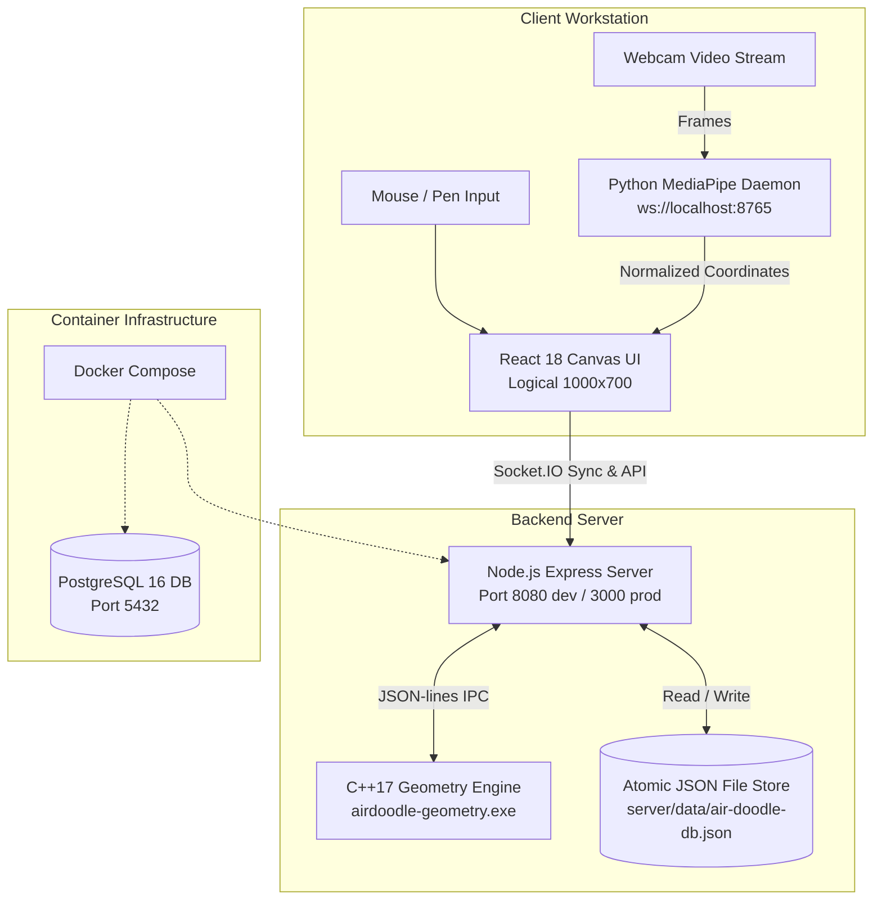

# AirDoodle — Gesture-Driven 2D Workspace

AirDoodle is an integrated, gesture-driven 2D design workspace combining computer vision, high-performance geometry algorithms, real-time collaboration, and a modern responsive web canvas.

It allows creators and teams to sketch, annotate, and organize shapes in free space using webcam hand tracking or mouse input, with automatic geometric shape recognition and multi-user synchronization.

---

## 1. Feature Status

| Feature | Status | Description |
| :--- | :--- | :--- |
| **Unified 2D Canvas** | **Implemented** | 1000 × 700 logical SVG workspace with pan/zoom, selection, rotation, scaling, and SVG export. |
| **Mouse & Touch Fallback** | **Implemented** | Full mouse/pen drawing and shape manipulation active out of the box when camera is offline. |
| **Python Vision Agent** | **Implemented** | Local MediaPipe + OpenCV daemon (`vision/agent_server.py`) streaming normalized gestures over WebSocket (`ws://localhost:8765`). |
| **C++17 Geometry Engine** | **Implemented** | Native subprocess (`cpp-engine`) performing line smoothing, affine transforms, and shape recognition via JSON-lines IPC. |
| **Real-Time Collaboration** | **Implemented** | Socket.IO room architecture for live multi-user shape broadcasting and remote cursor tracking. |
| **Authentication & Projects** | **Implemented** | User registration/login, PBKDF2/scrypt password hashing, session tokens, and project CRUD. |
| **Persistence (JSON Store)** | **Implemented** | Atomic in-memory + disk JSON file storage (`server/data/air-doodle-db.json`) for zero-dependency instant startup. |
| **PostgreSQL Database** | **Partial** | Container provisioned in Docker Compose; active engine uses JSON store; direct SQL driver planned. |
| **Docker Compose Deployment**| **Implemented** | Multi-stage Docker build packaging C++ native binary, built web client, Express server, and PostgreSQL. |

---

## 2. Architecture Overview



---

## 3. Technology Stack

- **Frontend:** React 18, Vite 7, TypeScript, Tailwind CSS 3, Radix UI primitives, Lucide Icons, Framer Motion.
- **Backend:** Node.js, Express 5, Socket.IO 4, Zod, Node.js Crypto (scrypt & HMAC-SHA256).
- **Vision Agent:** Python 3.10+, OpenCV 4+, MediaPipe 0.10+, WebSockets (`asyncio`).
- **Geometry Engine:** C++17, CMake 3.16+, GCC 12 / MSVC 2022.
- **Persistence:** Atomic JSON file store (`server/data/air-doodle-db.json`); PostgreSQL 16 Alpine (Docker).
- **Containerization:** Multi-stage `Dockerfile`, `docker-compose.yml`.

---

## 4. Repository Structure

```text
AirDoodle/
├── air-doodle-frontend/          # Web frontend & Express orchestration server
│   ├── client/                   # React 18 + Vite SPA (Canvas, Toolbar, Topbar, Pages)
│   ├── server/                   # Express backend (routes, db.ts, geometry-engine.ts, socket.ts)
│   │   └── data/                 # JSON database persistence (air-doodle-db.json)
│   ├── shared/                   # Common TypeScript interfaces & shape contracts
│   ├── package.json & pnpm-lock.yaml
│   └── vite.config.ts
├── cpp-engine/                   # C++17 Geometry Engine
│   ├── CMakeLists.txt            # Build definitions
│   ├── src/                      # Native recognition, geometry, and main loop
│   ├── tests/                    # C++ geometry unit test suite
│   └── build/                    # Compiled native binaries (airdoodle-geometry.exe)
├── vision/                       # Python Vision Agent Package
│   ├── agent_server.py           # WebSocket server daemon (ws://localhost:8765)
│   ├── tracking/                 # HandTracker with MediaPipe
│   └── gestures/                 # GestureRecognizer (static and swipe gestures)
├── docs/                         # Specifications & Verification Records
│   ├── architecture.md           # Runtime architecture & data flow
│   ├── contract.md               # API, WebSocket, and Socket.IO contracts
│   └── integration-validation.md # Full-stack verification test report
├── tests/                        # Python integration test suite
│   ├── test_gesture_recognizer.py
│   └── test_vision_agent.py
├── utils/                        # Legacy compatibility imports (forwarding to vision/)
├── legacy/                       # Historical early prototype phase scripts (1 to 5)
│   ├── phase1_hand_tracking.py
│   ├── phase2_gesture_recognition.py
│   ├── phase3_air_writing.py
│   ├── phase4_device_control.py
│   └── phase5_authentication.py
├── docker-compose.yml            # Multi-service container orchestration
├── Dockerfile                    # Multi-stage production container build
├── README.md                     # Project documentation (this file)
└── CHANGES.md                    # Chronological implementation log
```

---

## 5. Prerequisites & Environment

- **Node.js:** v18.x, v20.x, or v22.x+ (tested on Node 20 & 24)
- **Python:** 3.10.x or 3.11.x (with `opencv-python`, `mediapipe`, `websockets`)
- **C++ Compiler:** C++17 compliant compiler (GCC/G++, Clang, or MSVC) & CMake 3.16+
- **Docker:** Docker Desktop (optional, for containerized deployment)

---

## 6. Installation & Quick Start

### Step 1: Install Frontend & Backend Dependencies

```powershell
cd air-doodle-frontend
npm install
```

### Step 2: Install Vision Agent Dependencies

From the project root:

```powershell
pip install -r requirements.txt websockets
```

### Step 3: Compile C++ Geometry Engine (Optional, pre-built binary included)

```powershell
cd cpp-engine
mkdir build
cd build
cmake ..
cmake --build . --config Release
```

---

## 7. Running the Application

### Option A: Standard Full-Stack Workspace

1. **Start the Frontend & Express Backend (Terminal 1):**
   ```powershell
   cd air-doodle-frontend
   npm run dev
   ```
   Open [http://localhost:8080](http://localhost:8080) in your browser.

2. **Start the Vision Agent (Terminal 2):**
   ```powershell
   python vision/agent_server.py
   ```
   *Note: If no webcam is attached or you want simulated gestures, run:*
   ```powershell
   python vision/agent_server.py --test-mode
   ```

### Option B: Production Node.js Server

```powershell
cd air-doodle-frontend
npm run build
npm start
```
The production server runs on port 3000: [http://localhost:3000](http://localhost:3000).

### Option C: Docker Compose

```powershell
docker compose up --build
```
Access the application at [http://localhost:3000](http://localhost:3000).

---

## 8. Verification & Test Commands

### Run Frontend Typecheck & Unit Tests
```powershell
cd air-doodle-frontend
npm run typecheck
npm test
```

### Run Python Test Suite
```powershell
python -m unittest discover tests
```

### Run C++ Engine Tests
```powershell
cd cpp-engine
.\build\test_geometry.exe
```

---

## 9. API & Socket Protocols

- **REST Endpoints:**
  - `GET /api/ping` — Server health check
  - `POST /api/auth/register` — Create account (`{ name, email, password }`)
  - `POST /api/auth/login` — Login (`{ email, password }`)
  - `GET /api/auth/me` — Authenticated user info (`Bearer <token>`)
  - `GET /api/projects` — List user projects
  - `POST /api/projects` — Create new project
  - `GET /api/projects/:id` — Load project canvas shapes
  - `PUT /api/projects/:id` — Update project title or shapes (enforces ownership)
  - `DELETE /api/projects/:id` — Delete project (enforces ownership)
  - `POST /api/recognize` — Recognize raw stroke points into geometric shape

- **WebSocket (Vision Agent):** `ws://localhost:8765` emitting `cursorMoved`, `penDown`, `penUp`, `strokeFinished`.
- **Socket.IO (Collaboration):** Room `project:${id}` with events `project:join`, `shape:create`, `shape:update`, `shape:delete`, `cursor:move`.

---

## 10. Persistence & Authentication Behavior

- **Authentication:** Scrypt password hashing with 16-byte random salts; stateless HMAC-SHA256 signed tokens (7-day validity). Default test account (development only): `demo@airdoodle.com` / `password123`.
- **Session Secret Security:**
  - In **production** (`NODE_ENV=production`), `SESSION_SECRET` **must** be provided via environment variables with a minimum length of 32 characters (e.g. `openssl rand -base64 32`). If missing or too short, the server aborts startup immediately with a clear error.
  - In **development**, a built-in development fallback is provided so the project runs with zero initial setup.
- **Authorization:** Only project owners or users modifying the default demo projects can update or delete project records.
- **Persistence Storage:** Automatically reads and writes to `air-doodle-frontend/server/data/air-doodle-db.json`. Client transparently falls back to local storage when working completely offline.

---

## 11. Known Limitations & Roadmap

- **Database Adapter:** PostgreSQL container is provisioned via Docker, but currently the server uses atomic JSON persistence. A future phase will introduce Prisma/Kysely migrations for direct PostgreSQL queries.
- **Webcam Permissions:** Browser requires a local running Python process (`vision/agent_server.py`) with webcam permissions to stream gestures. When unavailable, the UI automatically falls back to mouse/pen drawing.
